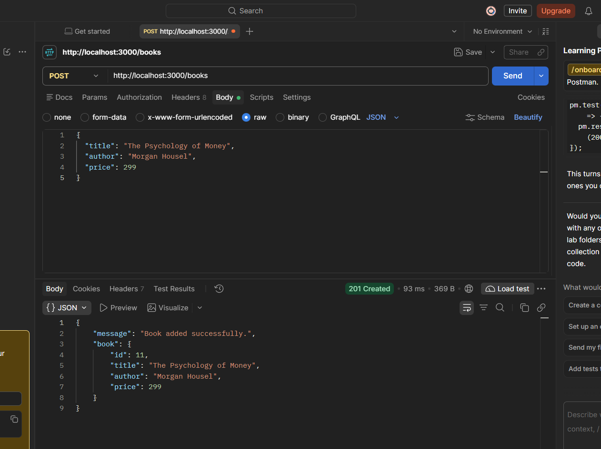
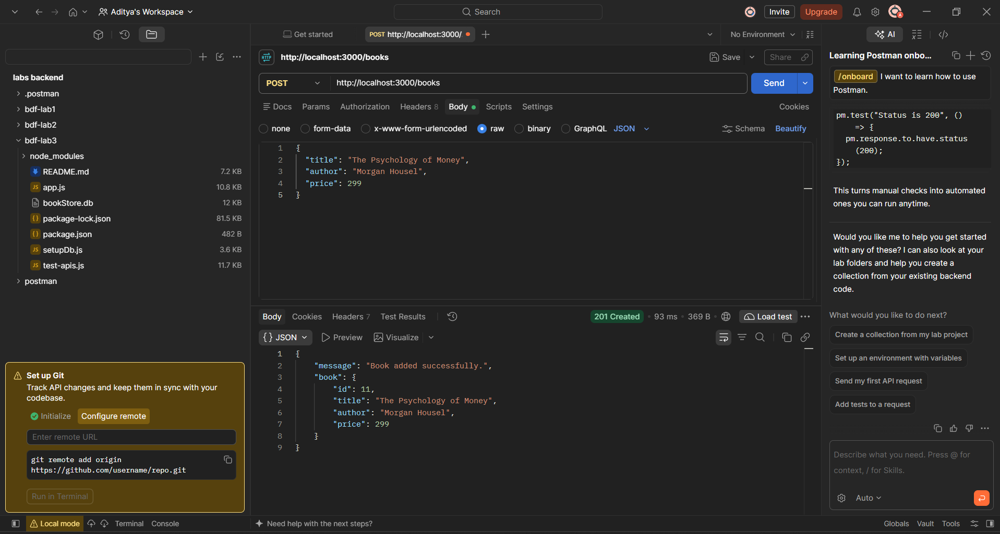
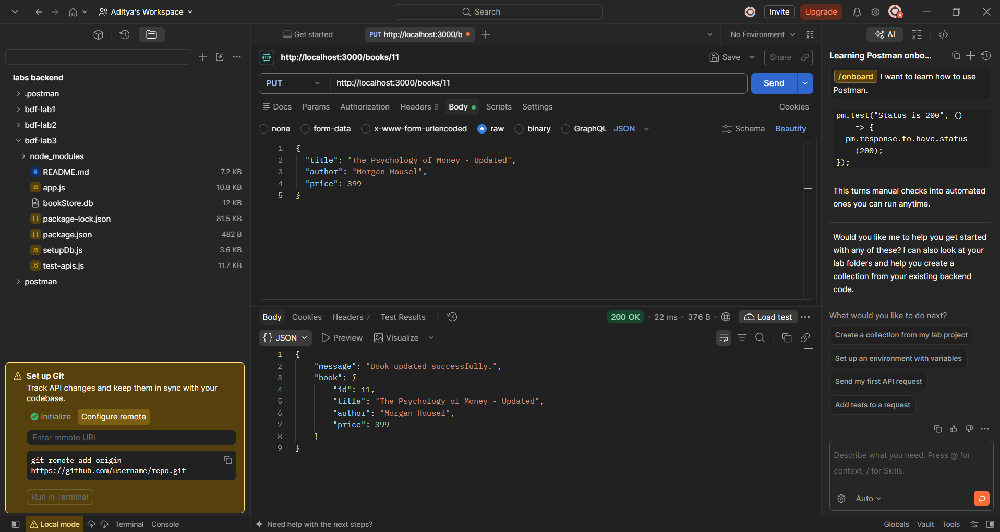
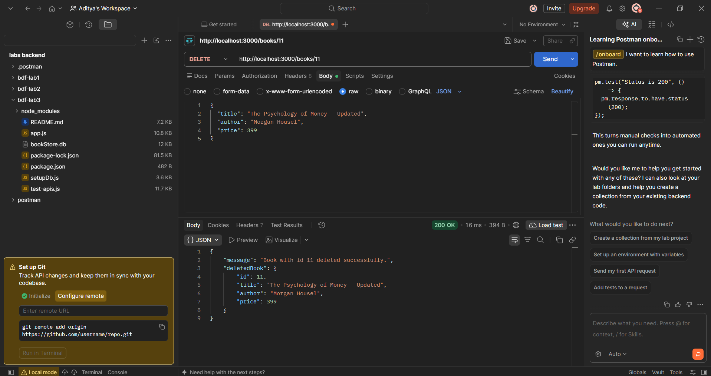
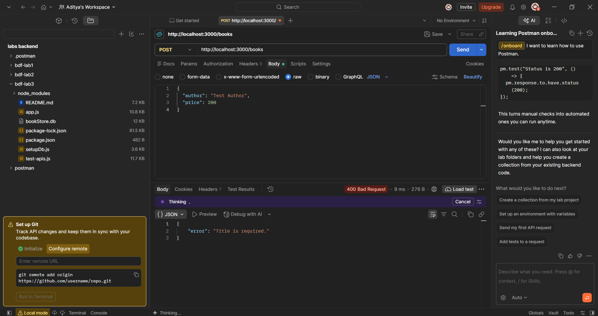
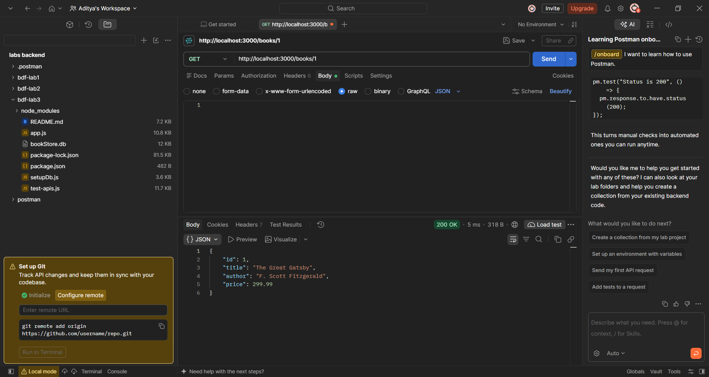
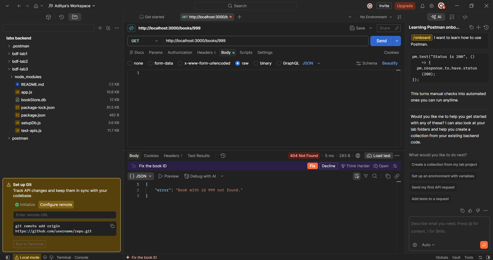
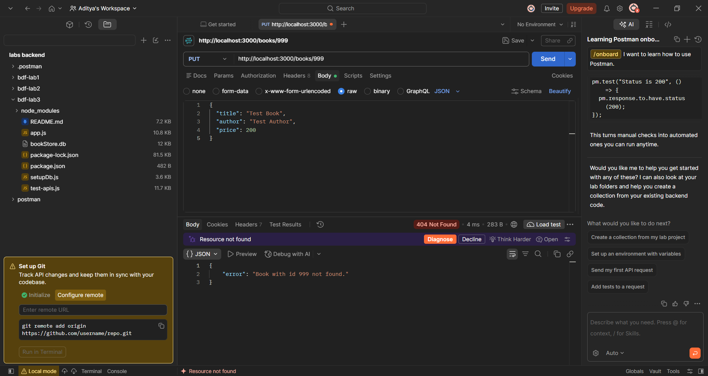
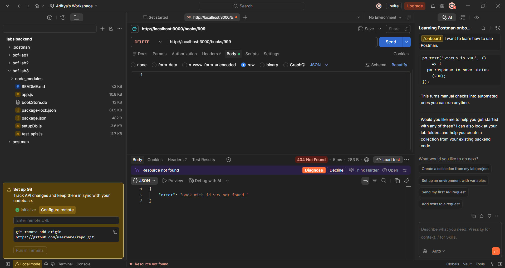

# Backend Development Fundamentals – Lab 3

## REST API with Query Parameters, Validation, and CRUD Operations

### Student Details

- **Name:** Aditya Amancha
- **Section:** AI/DE-2A
- **Course:** Backend Development Fundamentals
- **Lab:** 3

---

## Live Deployment

**Render URL:** https://adithya-amancha-bdl-3.onrender.com

---

## Project Overview

This project implements a RESTful API for managing a collection of books using Node.js, Express.js, and SQLite.

The API supports CRUD operations (Create, Read, Update, and Delete), along with query parameters for searching, sorting, filtering, and pagination. It also includes input validation and appropriate HTTP status codes for handling invalid requests.

---

## Technologies Used

- Node.js
- Express.js
- SQLite
- SQLite3
- JavaScript
- Postman
- Render

---

## Features

- Retrieve all books
- Retrieve a specific book by ID
- Search books using query parameters
- Sort books based on supported fields
- Filter books by price
- Implement pagination using limit and offset
- Create new books
- Update existing books
- Delete books
- Validate request data
- Handle missing and invalid inputs
- Use parameterized SQL queries
- Deploy the API using Render

---

## API Endpoints

### 1. Get All Books

**Method:** `GET`

```http
GET /books/
```

Retrieves all books stored in the database.

### 2. Search Books

**Method:** `GET`

```http
GET /books/?search=Harry
```

Searches for books based on the provided search query.

### 3. Sort Books

**Method:** `GET`

```http
GET /books/?sort_by=price&order=asc
```

Sorts books based on the selected field and order.

### 4. Pagination

**Method:** `GET`

```http
GET /books/?limit=5&offset=0
```

- `limit`: Number of books to retrieve.
- `offset`: Number of records to skip.

### 5. Filter Books by Price

**Method:** `GET`

```http
GET /books/?min_price=100&max_price=500
```

Retrieves books within the specified price range.

### 6. Get Book by ID

**Method:** `GET`

```http
GET /books/:id/
```

Retrieves details of a specific book using its ID.

### 7. Create a Book

**Method:** `POST`

```http
POST /books/
```

Example request body:

```json
{
  "title": "Sample Book",
  "author": "Sample Author",
  "price": 250
}
```

Creates a new book record in the database.

### 8. Update a Book

**Method:** `PUT`

```http
PUT /books/:id/
```

Example request body:

```json
{
  "title": "Updated Book",
  "author": "Updated Author",
  "price": 300
}
```

Updates the details of an existing book.

### 9. Delete a Book

**Method:** `DELETE`

```http
DELETE /books/:id/
```

Deletes a book record using its ID.

---

## Input Validation

The API validates incoming data before processing requests.

Validation includes:

- Checking whether the title is provided.
- Checking whether the author is provided.
- Checking whether the price is provided and valid.
- Handling missing required fields.
- Returning appropriate error responses for invalid data.

### Validation Test Cases

| Test Case | Expected Status |
|---|---|
| Missing title | 400 Bad Request |
| Missing author | 400 Bad Request |
| Invalid price | 400 Bad Request |

---

## Database

The project uses SQLite to store book records.

The database contains a `books` table with the following fields:

| Field | Description |
|---|---|
| `id` | Unique identifier for each book |
| `title` | Title of the book |
| `author` | Author of the book |
| `price` | Price of the book |

Parameterized SQL queries are used to help prevent SQL injection.

---

## Project Structure

```text
bdf-lab3/
│
├── app.js
├── bookStore.db
├── package.json
├── package-lock.json
├── README.md
├── setupDb.js
│
└── screenshots/
    ├── GET_All_Books.png
    ├── GET_Search_Books.png
    ├── GET_Sort_Books.png
    ├── GET_Limit_Offset.png
    ├── GET_Price_Filter.png
    ├── POST_Create_Book.png
    ├── PUT_Update_Book.png
    ├── DELETE_Book.png
    ├── POST_Missing_Title_400.png
    ├── POST_Missing_Author_400.png
    └── POST_Invalid_Price_400.png
```

---

## Installation and Setup

### 1. Clone the Repository

```bash
git clone https://github.com/adityaaaaaw/Adithya_Amancha_BDL-3.git
```

### 2. Navigate to the Project Directory

```bash
cd Adithya_Amancha_BDL-3
```

### 3. Install Dependencies

```bash
npm install
```

### 4. Start the Server

```bash
node app.js
```

The server will run on:

```text
http://localhost:3000
```

---

## Screenshots

The following screenshots demonstrate the API functionality and validation.

### GET – All Books



### GET – Search Books



### GET – Sort Books



### GET – Limit and Offset



### GET – Price Filter



### POST – Create Book


### PUT – Update Book


### DELETE – Delete Book



### Validation – Missing Title



### Validation – Missing Author



### Validation – Invalid Price



---

## Deployment

The application is deployed on Render.

**Live API:** https://adithya-amancha-bdl-3.onrender.com

---

## Conclusion

This lab helped in understanding the development of RESTful APIs using Node.js and Express.js. It provided practical experience in implementing CRUD operations, handling query parameters, applying search and sorting functionality, and managing pagination and price filtering.

The lab also demonstrated the importance of input validation, error handling, and parameterized SQL queries while developing backend applications. The API was deployed using Render, providing experience in making backend services accessible online.

